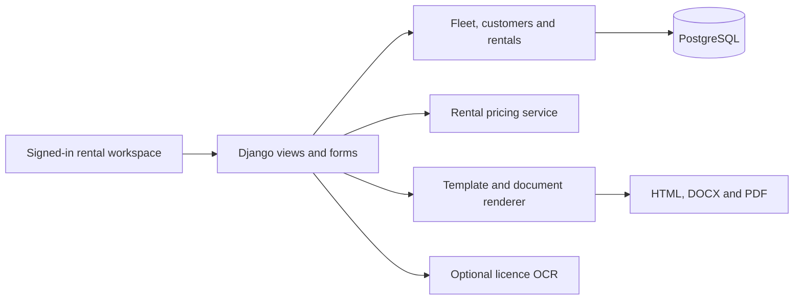

# Contract workflow

A Django workspace for car-rental operations. Contract workflow connects fleet and
customer records with rental pricing, agreement templates and document generation,
so the information entered for a rental can carry through to its contract.

## Capabilities

- **Fleet and customer records:** vehicles, customer profiles, tags, notes,
  document fields, search and import/export workflows.
- **Rental workflow:** a guided rental form, second-driver information, rental
  dates, equipment, prepayments and outstanding balances.
- **Pricing:** seasonal rate bands, rental duration, delivery locations, night
  fees, equipment and configured discounts.
- **Contracts:** reusable templates and placeholder substitution for HTML,
  DOCX and PDF output.
- **Business settings:** seasonal boundaries, equipment prices, delivery fees
  and operational defaults.
- **Optional OCR:** a driving-licence extraction pipeline with parsing and image
  preprocessing. Extracted information still needs human review.

## Architecture



| Layer | Implementation |
| --- | --- |
| Application | Python, Django 5, server-rendered templates |
| Persistence | PostgreSQL, Django ORM and migrations |
| Documents | python-docx, pypdf, xhtml2pdf, ReportLab |
| Import and OCR | openpyxl/xlrd, OpenCV, PaddleOCR |
| Runtime | Gunicorn, WhiteNoise, Docker tooling |

## Reproduce the core behavior offline

The reviewer/CI profile uses Python 3.12, temporary SQLite, synthetic documents
created in memory, and a mocked OCR endpoint. It does not download OCR models or
connect to a customer database.

```bash
python3.12 -m venv .venv
. .venv/bin/activate
python -m pip install -r ci/requirements.txt
python scripts/test_offline.py
python manage.py makemigrations --check --dry-run --settings=car_rental.test_settings
python scripts/check_public_history.py
```

[CI](.github/workflows/ci.yml) runs these checks with network calls forbidden in
the test process. [A synthetic document walkthrough](docs/ENGINEERING_CASE.md)
connects the business rules, renderer and privacy boundary to the relevant tests.

Full local development, private template configuration and optional OCR inference
use the broader runtime dependencies; follow [Development](docs/DEVELOPMENT.md).
Use your own local account and empty data. The tracked environment example contains
placeholders; `.env` and operational uploads must remain outside version control.

## Source map

| Area | Code and examples |
| --- | --- |
| Settings and application routes | [car_rental/](car_rental/) |
| Rental data model | [rentals/models.py](rentals/models.py) |
| Forms and guided workflow | [rentals/forms.py](rentals/forms.py) · [views](rentals/views.py) |
| Pricing rules | [rentals/services/pricing.py](rentals/services/pricing.py) |
| Contract generation | [rentals/services/contract_renderer.py](rentals/services/contract_renderer.py) |
| OCR pipeline | [rentals/ocr/](rentals/ocr/) |
| Existing regressions | [rentals/tests/](rentals/tests/) |
| Privacy and publication boundaries | [Privacy](docs/PRIVACY.md) |
| Setup and document boundaries | [Development](docs/DEVELOPMENT.md) |

## Scope and limitations

OCR can misread identity information; inspect extracted values before saving or
generating a contract. Templates and pricing settings must match the intended
business rules. Generated documents are application output, not a guarantee of
legal suitability.

Local startup requires configured environment values and PDF/OCR dependencies.
Use dedicated local data and review the intended storage and access rules before
processing customer documents. The deterministic CI profile does not validate OCR inference quality, deployment
readiness or PostgreSQL concurrency. No new licence is granted; third-party asset
notices remain intact.
